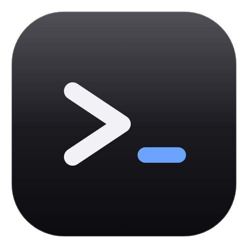
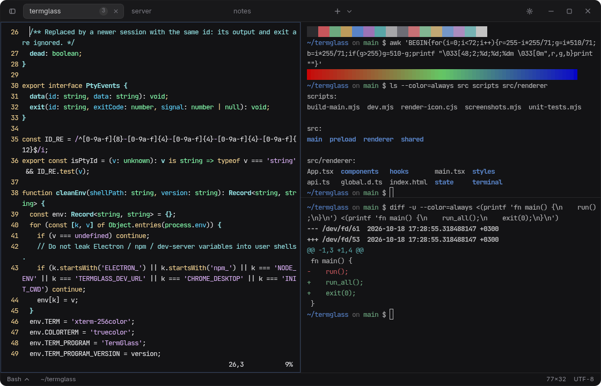
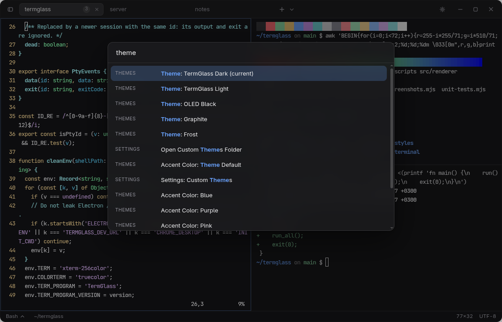
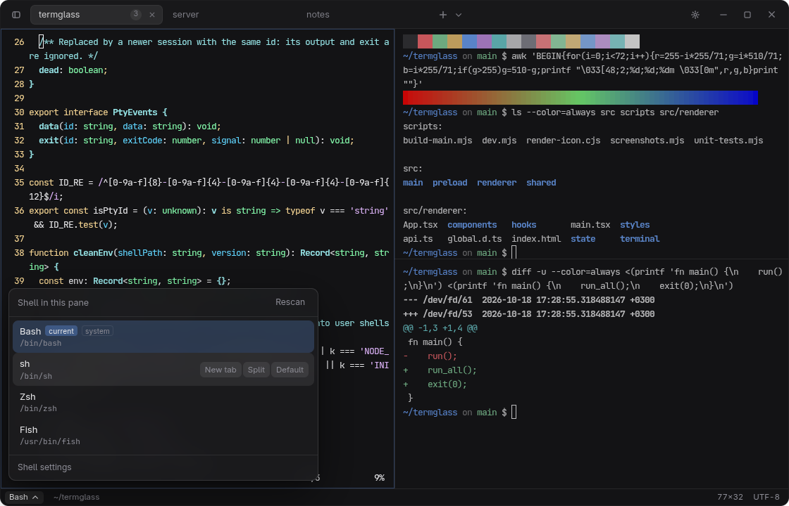
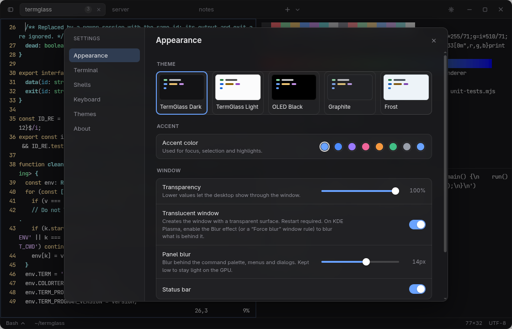
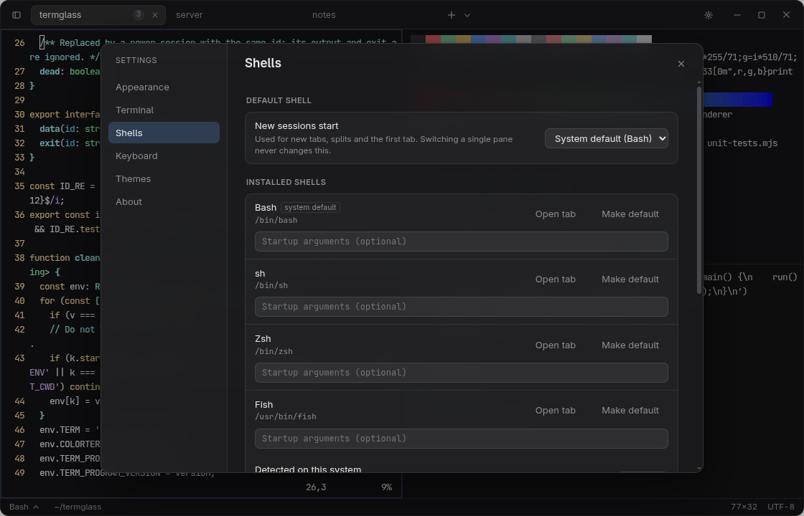
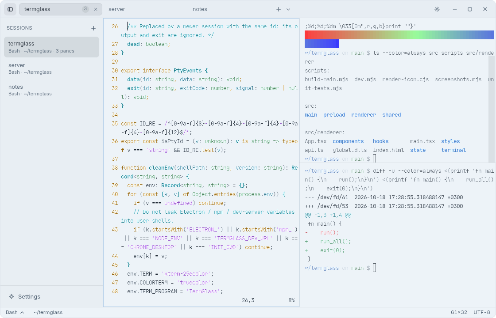

<div align="center">



# TermGlass

**A minimal, glass-inspired terminal emulator for the desktop.**<br>
Real shells, split panes, a command palette, themes and a shell selector — built with Electron, xterm.js and node-pty.

**English** · [Русский](README.ru.md)




</div>

Every pane is a real pseudoterminal running your real shell. There is no command simulation anywhere: vim, nano, htop, ssh and your own prompt behave exactly as they do in any other terminal.

## Highlights

- **Real terminal.** node-pty for the PTY, xterm.js for rendering (WebGL with an automatic fallback), truecolor, UTF-8 with grapheme-aware Unicode, mouse reporting, bracketed paste, scrollback up to 100,000 lines, search, copy/paste.
- **Tabs and splits.** Rename and drag to reorder tabs; horizontal and vertical splits with drag-to-resize; every pane has its own PTY and its own shell.
- **Shell selector.** Detects the shells installed on your machine, switches a pane's shell in one click while keeping the working directory, opens tabs and splits with any shell. [Details](#shell-management).
- **Command palette** (`Ctrl+Shift+P`) with fuzzy search for commands, tabs, themes, shells and settings.
- **Five built-in themes** plus custom JSON themes that reload live. Palettes are unit-tested for readable contrast.
- **Fully remappable shortcuts**, a collapsible sidebar and a quiet status bar.
- **Careful close behaviour.** Confirms before ending a running program, never for an idle prompt; every shell is terminated when the app quits.
- **Secure by construction.** Sandboxed renderer, context isolation, strict CSP, validated IPC and no "run this command" channel. [Details](#security-model).
- **Prompt icons work.** Installed Nerd Fonts are used as glyph fallbacks, so Starship and Powerlevel10k icons render.

## Screenshots

| Command palette | Shell selector |
| --- | --- |
|  |  |

| Settings: appearance | Settings: shells |
| --- | --- |
|  |  |

| Frost theme with the sidebar open |
| --- |
|  |

Screenshots come from `node scripts/screenshots.mjs`, which drives the built app with real commands (vim, `ls`, `diff`, ANSI colour ramps). The shell list shows what is installed on the machine that took them.

## Status

TermGlass targets **Linux first (Arch, CachyOS, KDE Plasma, Wayland)**, then Windows. This table is deliberately blunt about what has and has not been exercised.

| Area | State |
| --- | --- |
| Linux (CachyOS, KDE Plasma, Wayland session, Electron 44) | Built, packaged (AppImage and tar.gz) and covered by 39 unit tests and two end-to-end suites (45 general checks, 32 shell-management checks) that drive the real app with real keystrokes |
| Terminal behaviour | Verified end to end with bash and zsh: Ctrl+C / Ctrl+D / Ctrl+Z, job control, vim, nano and htop full-screen, truecolor, UTF-8 (accents, CJK, emoji), resize reaching the shell (`stty size`), 1.5M lines of output, clipboard, process cleanup on quit |
| Shell detection and switching | Verified on Linux with real bash, zsh, fish and sh: detection, selector, one-click switching (working directory kept, old process cleaned up, confirmation only for a running program), new tab and split with a chosen shell, default shell, custom shell, startup arguments, rescan, fallback from a removed shell |
| Windows | **Untested on real Windows.** Detection of pwsh, Windows PowerShell, cmd, Git Bash and WSL distributions is unit-tested against fake filesystems and recorded `wsl.exe` output, but nothing has run on a real Windows machine (including ConPTY, native caption buttons and acrylic). NSIS and portable targets are configured but have not been built |
| macOS | **Untested and not packaged.** Some code paths exist (traffic lights, vibrancy, ⌘ shortcuts) |
| AppImage | Built, **not launched** (the unpacked build and the Arch package contents were launched) |
| Window blur on Linux | Electron cannot blur behind its own window on Linux; blur needs a compositor feature such as KWin's Blur effect. Not verified here |
| HiDPI and fractional scaling, IME input, SSH to a real host, frameless drag/resize feel on Wayland | Not verified |

## Install

**Prebuilt packages** are on the [Releases page](https://github.com/NettixDev-ctrl/TermGlass/releases), built by GitHub Actions from tagged commits:

| File | For |
| --- | --- |
| `termglass-*.pkg.tar.zst` | Arch Linux / CachyOS: `sudo pacman -U termglass-*.pkg.tar.zst` |
| `TermGlass-*-linux-x64.AppImage` | Any Linux: `chmod +x` it and run (not launched by the author yet) |
| `TermGlass-*-linux-x64.tar.gz` | Any Linux, unpacked |
| `TermGlass-Setup-*.exe`, `TermGlass-*-portable.exe` | Windows (**untested**) |

Every release includes `SHA256SUMS.txt`. **To build from source instead:**

```bash
git clone https://github.com/NettixDev-ctrl/TermGlass.git
cd TermGlass
npm install
```

**Arch Linux / CachyOS** (a proper package that pacman can remove again):

```bash
packaging/arch/build.sh
sudo pacman -U packaging/arch/termglass-*.pkg.tar.zst
```

**Other Linux** (AppImage and tar.gz in `release/`):

```bash
npm run dist:linux
```

**Windows** (run on Windows; untested): `npm run dist:win`

**Run without installing:** `npm run build && npm run start`

Requirements: Node.js 20+ (developed with Node 26), a C++ toolchain, Python and `make` for rebuilding `node-pty` against Electron (on Arch: `sudo pacman -S --needed base-devel python`). If npm reports blocked install scripts, the project's own `postinstall` still runs; if `node-pty` fails to load, run `npm run rebuild`.

Running `termglass` again while it is already open focuses the window and opens a **new tab**, which makes it a good target for a global shortcut such as `Ctrl+Alt+T`.

## Usage

- **Tabs:** `Ctrl+Shift+T` new, double-click or `Ctrl+Shift+R` rename, drag to reorder, middle-click to close, `Alt+1`–`Alt+9` jump (`⌘1`–`⌘9` on macOS).
- **Panes:** `Ctrl+Shift+D` split right, `Ctrl+Shift+E` split down, `Alt+Shift+Arrows` move focus, drag a divider to resize (double-click resets it).
- **Search:** `Ctrl+Shift+F`. **Copy and paste:** `Ctrl+Shift+C` / `Ctrl+Shift+V`. Plain `Ctrl+C`, `Ctrl+D` and `Ctrl+Z` always reach the shell.
- **Links:** Ctrl+click opens `http(s)` links in the output.

Defaults avoid clashing with terminal programs: on Linux and Windows most shortcuts use `Ctrl+Shift`. Everything can be remapped in **Settings → Keyboard**.

<details>
<summary><b>All default shortcuts</b></summary>

| Action | Linux / Windows | macOS |
| --- | --- | --- |
| Command Palette | `Ctrl+Shift+P` | `⇧⌘P` |
| Open Settings | `Ctrl+,` | `⌘,` |
| New Tab | `Ctrl+Shift+T` | `⌘T` |
| Close Tab | `Ctrl+Alt+W` | `⇧⌘W` |
| Next Tab | `Ctrl+Tab / Ctrl+PgDn` | `⌃Tab / ⇧⌘]` |
| Previous Tab | `Ctrl+Shift+Tab / Ctrl+PgUp` | `⌃⇧Tab / ⇧⌘[` |
| Rename Tab | `Ctrl+Shift+R` | `⇧⌘R` |
| Split Right | `Ctrl+Shift+D` | `⌘D` |
| Split Down | `Ctrl+Shift+E` | `⇧⌘D` |
| Close Pane | `Ctrl+Shift+W` | `⌘W` |
| Focus Pane Left | `Alt+Shift+←` | `⌥⌘←` |
| Focus Pane Right | `Alt+Shift+→` | `⌥⌘→` |
| Focus Pane Above | `Alt+Shift+↑` | `⌥⌘↑` |
| Focus Pane Below | `Alt+Shift+↓` | `⌥⌘↓` |
| Focus Next Pane | `Ctrl+Shift+]` | `⌘]` |
| Focus Previous Pane | `Ctrl+Shift+[` | `⌘[` |
| Switch Shell… | `Ctrl+Shift+S` | `⇧⌘S` |
| Copy | `Ctrl+Shift+C` | `⌘C` |
| Paste | `Ctrl+Shift+V` | `⌘V` |
| Select All | `Ctrl+Shift+A` | `⌘A` |
| Clear Scrollback | `Ctrl+Shift+K` | `⌘K` |
| Find in Terminal | `Ctrl+Shift+F` | `⌘F` |
| Increase Font Size | `Ctrl+= / Ctrl+Shift+=` | `⌘= / ⇧⌘=` |
| Decrease Font Size | `Ctrl+-` | `⌘-` |
| Reset Font Size | `Ctrl+0` | `⌘0` |
| Toggle Sidebar | `Ctrl+Shift+B` | `⇧⌘B` |
| Toggle Full Screen | `F11` | `⌃⌘F` |
| Toggle Developer Tools | `Ctrl+Shift+I` | `⌥⌘I` |
| Quit TermGlass | `Ctrl+Shift+Q` | `⌘Q` |

Commands without a default shortcut (duplicate tab, restart shell, rescan shells, …) are available from the command palette.

</details>

## Shell management

**Detection** runs in the main process and repeats on demand (*Rescan*). Only executables that exist and can be launched are listed, deduplicated by executable: `/bin/bash` and `/usr/bin/bash` are one shell, but `sh` stays separate even when it is a symlink to bash.

| Platform | Sources |
| --- | --- |
| Linux / macOS | your login shell from the user database, `$SHELL`, every entry of `/etc/shells`, and a search of `PATH` plus common locations (`/usr/local/bin`, Homebrew, `~/.cargo/bin`, `~/.nix-profile/bin`, `/snap/bin`) for bash, zsh, fish, nu, dash, sh, elvish, xonsh, ksh, mksh, ash, tcsh, csh, pwsh, osh, ysh, murex, ion, yash and rc. Placeholders such as `nologin`, `git-shell` and `systemd-home-fallback-shell` are ignored |
| Windows | PowerShell 7+ (PATH, `Program Files\PowerShell\*`, Store alias), Windows PowerShell, cmd.exe, Git Bash (install folders, or derived from `git.exe` on PATH; `System32\bash.exe` is the WSL launcher and is not offered as Git Bash), MSYS2/Cygwin-style shells on PATH, and WSL distributions from `wsl.exe --list`. For *running* distributions their login shells are listed as well; stopped distributions are never started just to look around |

**System default** is your login shell on Unix. Windows has no per-user login shell, so TermGlass prefers pwsh, then Windows PowerShell, then cmd.

**Selector.** Click the shell name in the status bar, the chevron next to the new-tab button, or press `Ctrl+Shift+S`. Each row shows the name and executable path and is tagged `system`, `default` (a shell you chose explicitly) or `current` (running in the active pane). Click a row to switch the active pane; hover for *New tab*, *Split* (hold Alt for split down) and *Default*. Keyboard: arrows, `Enter`, `Shift+Enter`, `Alt+Enter`.

**Switching** starts the new shell first, in the old shell's working directory (read from `/proc`, so Linux only), and only then terminates the old one; if the new shell cannot start, the pane is untouched. Scrollback is kept. You are asked for confirmation **only** when the pane is running a program, never for an idle prompt.

**Settings → Shells** lists detected shells with paths, the default shell, a per-shell *startup arguments* field, and custom shells (any absolute path to an executable file, validated on every scan). If the saved default disappears, new sessions fall back to the system default and a notice says so.

Startup arguments are split into an argument vector by a small quote-aware parser and handed straight to the PTY spawn call; no shell interprets them, so `;`, `|` or `$(...)` are plain text.

## Themes

Built in: **TermGlass Dark** (default), **TermGlass Light**, **OLED Black**, **Graphite**, **Frost**. The unit tests check that every palette stays readable (foreground contrast ≥ 7:1, ANSI colours ≥ 3.5:1), and xterm's `minimumContrastRatio` is set per theme as a safety net.

Custom themes are `.json` files in the themes folder (Linux: `~/.config/TermGlass/themes/`, openable from **Settings → Themes**). They are picked up as soon as they are saved; invalid files are listed with the reason instead of being applied.

```json
{
  "id": "midnight-ink",
  "name": "Midnight Ink",
  "type": "dark",
  "ui": { "accent": "#b69cff" },
  "terminal": {
    "background": "#0d0f1a",
    "foreground": "#dfe3f5",
    "cursor": "#b69cff",
    "red": "#ff7a93",
    "green": "#9be3b0",
    "blue": "#7ea6ff"
  }
}
```

Only `type` (`"dark"` or `"light"`) is required. Missing terminal colours fall back to TermGlass Dark/Light, and missing UI colours are derived from the terminal palette. Colours accept `#rgb`, `#rrggbb`, `#rrggbbaa`, `rgb()` and `rgba()`. Terminal keys: `background foreground cursor cursorAccent selectionBackground black red green yellow blue magenta cyan white` and the `bright*` variants. UI keys: `background surface foreground muted border accent`. An optional `minimumContrastRatio` (1–21) overrides the default. More examples live in [`themes-examples/`](themes-examples).

## Settings and data

Theme, accent, font family / size / line height, cursor shape and blinking, shells (default, custom, startup arguments), login-shell flag, default directory, scrollback, window transparency, background blur, animations (full / reduced / off), status bar, GPU rendering and every keyboard shortcut. All of it is persisted locally and validated on load: unknown keys are dropped and out-of-range values are clamped.

| What | Linux | Windows |
| --- | --- | --- |
| Settings | `~/.config/TermGlass/settings.json` | `%APPDATA%\TermGlass\settings.json` |
| Custom themes | `~/.config/TermGlass/themes/` | `%APPDATA%\TermGlass\themes\` |
| Window size | `~/.config/TermGlass/window.json` | `%APPDATA%\TermGlass\window.json` |

## Platform notes

**Linux, Wayland, KDE Plasma.** On a Wayland session Electron picks native Wayland automatically. The window is frameless with TermGlass's own title bar and controls. *Settings → Appearance → Translucent window* creates the window with a transparent surface so the **Transparency** slider can show the desktop through it (restart required). Blur behind the window is a compositor feature: enable KWin's *Blur* effect and add the window class `termglass` to it. If a transparent window renders black on your system, start with `termglass --opaque` or set `"translucentWindow": false` in `settings.json`.

**Prompt icons** (Starship, Powerlevel10k) need a Nerd Font installed. TermGlass finds installed Nerd Fonts through fontconfig and uses them as glyph fallbacks; nothing is bundled. On Windows, choose a Nerd Font as the terminal font yourself.

**Windows.** Native caption buttons come from `titleBarOverlay`; transparency uses acrylic and needs Windows 11 22H2+ with *Background blur* on. Detecting a running program (for the close confirmation) relies on the PTY foreground process, which node-pty exposes on Linux and macOS but not on Windows; use *Confirm before closing → Always* there. All of this is untested.

## Architecture

```
src/
  main/            Electron main process: window, PTY manager, shell detection, settings and theme stores, IPC
  preload/         Sandboxed preload exposing a typed, narrow API on window.termglass
  shared/          Types, IPC channels, themes, settings validation, key bindings (no Node or DOM deps)
  renderer/
    components/    React UI: title bar, tabs, panes, palette, shell selector, settings, dialogs
    hooks/         Keyboard shortcuts, appearance (theme to CSS variables and xterm options)
    state/         Small external stores, split-tree logic, commands
    terminal/      TerminalSession (xterm + PTY glue) and registry, no React
    styles/        Design tokens and CSS
```

- **Terminal output never touches React state.** PTY data goes main → IPC → `TerminalSession.write()` → xterm. React only hosts each session's DOM element.
- **Panes are a flat list** positioned from the split tree, so splitting or closing a pane never moves or recreates another pane's canvas.
- **Back-pressure.** PTY output is coalesced (about 4 ms or 64 KB per message); the PTY is paused when about 1 MB is unacknowledged and resumed as xterm catches up.
- **One PTY per pane**, owned by the main process; the renderer refers to PTYs only by UUID.
- **WebGL only for visible panes**; hidden tabs release their context and xterm falls back to its DOM renderer if WebGL fails.

## Security model

- `contextIsolation: true`, `nodeIntegration: false`, `sandbox: true`, `webviewTag: false`; the preload exposes one typed object and never passes raw IPC events to the page.
- Strict Content-Security-Policy, navigation and `window.open` denied, all web permission requests denied.
- Every IPC handler checks that the sender is the app's own top-level frame and validates its payload. There is **no** channel that runs arbitrary commands: the renderer can only ask for a PTY with a shell **id** (never a path), resize/write/kill a PTY by UUID, use the clipboard, open `http(s)`/`mailto:` links and change validated settings.
- Shells run with a cleaned environment (no `ELECTRON_*`, `npm_*` or dev-server variables) and `TERM=xterm-256color`, `COLORTERM=truecolor`, `TERM_PROGRAM=TermGlass`.
- Custom theme files are size-limited and every colour is validated.

## Development

```bash
npm install
npm run dev          # Vite dev server + esbuild watch + Electron with auto-restart
npm run typecheck
npm run test:unit    # layout, fuzzy search, settings, themes, shortcuts, shell detection (Linux, Windows, WSL fakes)
npm run build
npm run test:e2e     # drives the built app; needs a display and bash + zsh + fish
```

`npm run test:e2e` launches the built app through Playwright's Electron driver in a throwaway `HOME` and user-data directory. See [CONTRIBUTING.md](CONTRIBUTING.md) for the project layout and rules.

## Known limitations

- Single window (a second launch focuses it and opens a tab); no session restore across restarts.
- No ligatures, sixel/image protocols or terminal multiplexing.
- Binary mouse reports (`onBinary`) are not forwarded.
- Keeping the working directory when switching shells uses `/proc`, so it is Linux only.
- Shell versions are not shown: detection never executes the shells it finds.
- Fonts are chosen by name; JetBrains Mono is bundled and is always the fallback.

## License

[MIT](LICENSE). JetBrains Mono is bundled under the SIL Open Font License 1.1.
